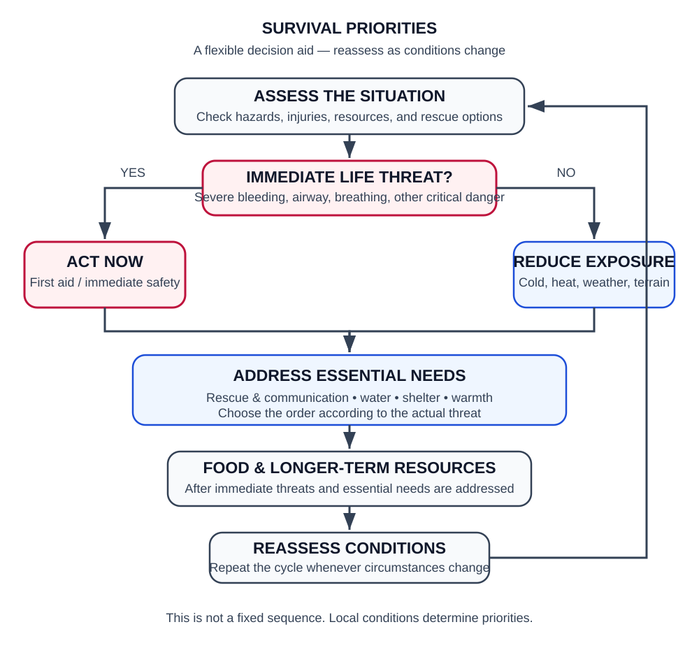

# Survival Priorities

## Objective
The aim is to set priorities to ensure survival. This can be summarised in the following steps:
- initial assessment of the situation;
- stabilisation before commencing secondary activities;
- the concept of dynamic priorities;
- the distinction between the first few minutes, the first 24 hours and the subsequent period.

### Dynamic Priorities

Survival priorities must be reassessed as conditions change.

1. **Immediate life threats:** Address severe bleeding, airway obstruction, breathing problems, and other immediately life-threatening conditions.
2. **Environmental protection:** Reduce exposure to cold, heat, wind, rain, and other immediate hazards.
3. **Rescue and communication:** Determine whether rescue is likely, communicate your location when possible, and avoid unnecessary movement when remaining in place is safer.
4. **Water:** Identify a suitable source and apply appropriate treatment.
5. **Sustained shelter and fire:** Establish protection and warmth when conditions and available resources require them.
6. **Food and longer-term resources:** Address these after immediate threats and essential needs have been assessed.

This order is a decision aid, not a universal sequence. For example, water may become the immediate priority in extreme heat, while shelter may be urgent in severe cold or dangerous weather.

## Dependencies and prerequisites
- assessment of physical conditions;
- assessment of the environment;
- available resources;
- time of day;
- weather;
- availability of rescue services;
- any immediate threats.

## Equipment
No specific list required.

## System

### first 24 hours
- Shelter
- Fire
- Water
- Food
- Signalling

### second 24 hours
- tools;
- search for resources;
- trapping/fishing;
- improving one’s position.

NOTE: severe bleeding, breathing difficulties or shock may become the top priority.

## Technology
- assessment;
- prioritisation;
- resource management;
- time management.

## Tools
- map;
- compass;
- survival kit;
- watch;
- notebook.

## Process
1. Stop and assess.
2. Check for injuries.
3. Assess immediate environmental threats.
4. Determine whether movement is necessary.
5. Set up shelter when exposure is a threat.
6. Light a fire when useful and safe.
7. Secure water.
8. Signal when rescue is expected or possible.
9. Only then should you seek food and resources.
10. Reassess priorities continuously.

## Notes
The priorities are not set in stone: temperature, injuries, water, threats and the possibility of rescue may alter them.
